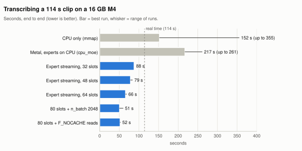
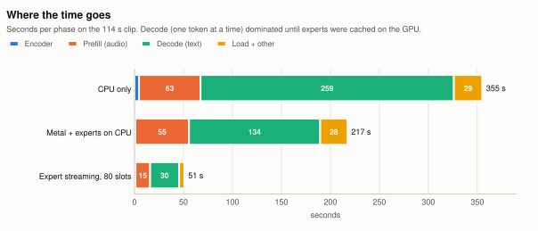
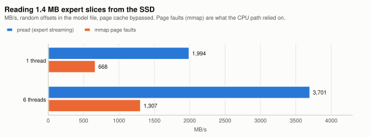
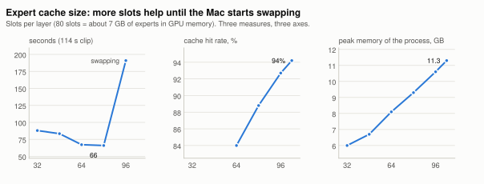
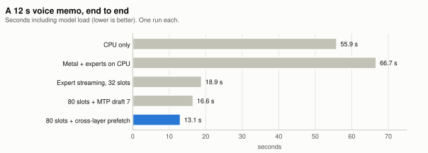
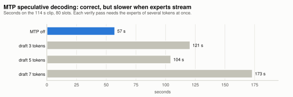

<div align="center">

<h1>NeMo-Speech.cpp</h1>

<p><strong>A lightweight native C++ runtime for the NVIDIA Nemotron Speech model family, with broad hardware support.</strong></p>

[Models](#models-and-applications) &nbsp;|&nbsp; [Installation](#installation) &nbsp;|&nbsp; [Quick Start](#quick-start) &nbsp;|&nbsp; [Documentation](#documentation) &nbsp;|&nbsp; [API Reference](docs/api.md)

</div>

> **NeMo-Speech.cpp is NVIDIA's official solution for local speech inference**,
> providing day-0 support for the latest models from
> [NVIDIA NeMo Speech](https://github.com/NVIDIA-NeMo/Speech), with native
> inference powered by [ggml](https://github.com/ggml-org/ggml).

## Nemotron 3.5 Transcribe on a 16 GB Mac (this fork)

This fork runs [Nemotron 3.5 Transcribe 30B-A4B](https://huggingface.co/nvidia/NVIDIA-Nemotron-3.5-Transcribe-30B-A4B)
on a 16 GB M4 MacBook, **about 2× faster than real time with the same transcript as the full CPU run**. The
decoder is a 34B-parameter mixture of experts. Even the community 2-bit GGUF
([AtomicChat `AD-Q2_0_M`](https://huggingface.co/AtomicChat/NVIDIA-Nemotron-3.5-Transcribe-30B-A4B-GGUF), 13.6 GB,
plus a 1.7 GB encoder) is larger than the 12.7 GB that macOS lets the GPU wire on a 16 GB machine. Upstream, the
choices are an out-of-memory error on Metal or a CPU run that pages weights in through mmap.

**How it differs from what already exists**

- NVIDIA's model card targets 24–80 GB GPUs, and the
  [AtomicChat GGUFs](https://huggingface.co/AtomicChat/NVIDIA-Nemotron-3.5-Transcribe-30B-A4B-GGUF) were measured on
  CUDA only. The MLX ports ([mlx-audio](https://github.com/Blaizzy/mlx-audio/pull/1087)) need about 20 GB at 4-bit.
  The [CoreML "Lite" port](https://huggingface.co/FluidInference/nemotron-3.5-transcribe-lite-coreml) does fit, but
  it drops the 30B language model, and its transcripts are much rougher (26% vs ~10–17% WER on meetings).
- SSD expert streaming already exists for MLX chat models (moe-stream, streamlx, flash-moe) and as an
  [open llama.cpp PR](https://github.com/ggml-org/llama.cpp/pull/25294), but not for a speech model or for
  NeMo-Speech.cpp. This fork ports that PR onto NeMo-Speech's llama.cpp, wires it into the speech-LLM (SALM)
  engine, and adds three changes:
  - macOS `F_NOCACHE` reads (macOS has no `O_DIRECT`)
  - **cross-layer expert prefetch**: the next MoE layer's router scores the current hidden state, and those
    experts start loading while the layers in between run
  - MTP drafting on the single-slot upstream path, through Mamba state snapshots

All of this runs the full model: the 30B language model, 40 languages, speaker tags, translation and word
timestamps. Every configuration below produced the same words as the CPU reference on the test clip.

<picture>
  <source media="(prefers-color-scheme: dark)" srcset="docs/apple-16gb/img/journey-dark.svg">
  
</picture>

**What changed, step by step** (114 s two-speaker clip, 16 GB M4, about 7 GB of other apps open; times vary
with memory pressure, so each bar is the best run and the whisker is the range):

| Step | What it does | Time |
|---|---|---|
| CPU only | Upstream: weights paged in through mmap | 152–355 s |
| `cpu_moe` | Experts stay mmapped on the CPU and everything else runs on Metal. `LLAMA_NO_DEVICE_MMAP` stops Metal wiring the whole interleaved file | 217–261 s |
| `moe_stream_slots N` | Experts are read with `pread` into a Metal cache of N experts per layer (llama.cpp PR 25294) | 88 s (32) → 66 s (64) |
| 80 slots, `n_batch 2048` | Biggest cache that fits next to other apps; larger prefill batches | 51–60 s |
| `moe_stream_nocache` | `F_NOCACHE`: experts are not held twice (cache slot and page cache) | 52 s, neutral |
| cross-layer prefetch | Predicts and loads the next MoE layer's experts during decode | 12 s memo: 16.6 → 13.1 s |

<picture>
  <source media="(prefers-color-scheme: dark)" srcset="docs/apple-16gb/img/phases-dark.svg">
  
</picture>

Decoding one token touches 6 of 128 experts in each of 23 MoE layers, about 0.4 GB. Paging that in through mmap
faults is what made the CPU path slow. Random 1.4 MB `pread`s from the SSD run 3–5× faster:

<picture>
  <source media="(prefers-color-scheme: dark)" srcset="docs/apple-16gb/img/reads-dark.svg">
  
</picture>

The cache size is set by free memory. Each slot is one expert per layer (about 87 MB across all 23 layers). Past
80 slots the hit rate keeps rising, but the Mac starts swapping:

<picture>
  <source media="(prefers-color-scheme: dark)" srcset="docs/apple-16gb/img/slots-dark.svg">
  
</picture>

<picture>
  <source media="(prefers-color-scheme: dark)" srcset="docs/apple-16gb/img/short-dark.svg">
  
</picture>

**What did not help:** MTP speculative decoding (`--asr.salm.mtp_draft`) now works on Metal, and its output
matches greedy decoding exactly. With streaming it is slower, though: each verify pass needs the experts of several
tokens at once, and the snapshots add about 1 GB. It is off by default.

<picture>
  <source media="(prefers-color-scheme: dark)" srcset="docs/apple-16gb/img/mtp-dark.svg">
  
</picture>

**Run it**

```bash
git clone --recursive -b apple-16gb https://github.com/JovanXin/NeMo-Speech.cpp && cd NeMo-Speech.cpp
brew install cmake ninja sentencepiece abseil ffmpeg
scripts/configure.sh metal-server && cmake --build --preset metal-server
hf download AtomicChat/NVIDIA-Nemotron-3.5-Transcribe-30B-A4B-GGUF --local-dir ~/models/nemotron-3.5-transcribe \
  --include "*Encoder-F16.gguf" --include "*AD-Q2_0_M.gguf"
scripts/apple/transcribe-16gb.sh memo.m4a                                    # text
scripts/apple/transcribe-16gb.sh call.wav --diarize -f json --word-times -o call.json
```

`SLOTS` sets the cache size: lower it if the Mac swaps, and raise it when apps are closed. `MAX_CTX` sets the
longest file, 8192 by default, about 7 minutes. `NEMO_SALM_PROFILE=1` prints per-phase times and cache hit rates.
`scripts/apple/bench.sh` and `scripts/apple/read_bench.c` reproduce the numbers above, and
`docs/apple-16gb/make_charts.py` redraws the charts.

**Caveats:** These numbers come from one machine, one 114 s clip (synthetic speech, two voices) and one 12 s clip.
They swing ±10% with whatever else is using memory. The streaming code comes from an unmerged llama.cpp PR, and it
assumes a single llama context per streamed model. The cross-layer prefetch was only measured on the 12 s clip.

## Models and applications

| Application | Supported models |
|---|---|
| Speech recognition | [Nemotron 3.5 ASR Streaming 0.6B](https://huggingface.co/nvidia/nemotron-3.5-asr-streaming-0.6b), [Nemotron Speech Streaming 0.6B](https://huggingface.co/nvidia/nemotron-speech-streaming-en-0.6b), [Parakeet TDT 0.6B v3](https://huggingface.co/nvidia/parakeet-tdt-0.6b-v3), and [Parakeet CTC 1.1B](https://huggingface.co/nvidia/parakeet-ctc-1.1b) |
| Speaker diarization | [Streaming Sortformer 4-speaker v2](https://huggingface.co/nvidia/diar_streaming_sortformer_4spk-v2) and [Nemotron 3 Diarization](https://huggingface.co/nvidia/Nemotron-3-Diarization), standalone or combined with ASR |
| Text and speech translation | [Riva Translate 4B Instruct v2](https://huggingface.co/nvidia/Riva-Translate-4B-Instruct-v2), with composed ASR-to-NMT-to-TTS speech translation |
| Speech synthesis | [MagpieTTS Multilingual 357M](https://huggingface.co/nvidia/magpie_tts_multilingual_357m) with [NeMo NanoCodec](https://huggingface.co/nvidia/nemo-nano-codec-22khz-1.89kbps-21.5fps) |
| Full-duplex voicechat | [Nemotron Labs VoiceChat](https://huggingface.co/nvidia/NVIDIA-NemotronLabs-VoiceChat-11B), including realtime audio, transcripts, and tool calling |
| Speech processing | [Silero VAD](https://github.com/snakers4/silero-vad), punctuation and capitalization, endpointing, text normalization, and subtitles |

## Performance

NeMo-Speech.cpp is blazing fast and built for real-time streaming. Speech recognition
transcribes audio in 160 ms chunks up to 67× faster than real time, and speech synthesis
generates speech up to 60× faster than real time with its first audio in under 10 ms. Both stay
faster than real time even on a CPU.

Streaming speech recognition with Nemotron Speech Streaming 0.6B (Q8_0), 160 ms chunks:

| Device | Latency per chunk | Throughput | Speedup over NeMo (FP32) |
|---|:---:|:---:|:---:|
| GeForce RTX 4090 | **2.3 ms** | **67× real time** | **8.8×** |
| CPU | **27 ms** | **6× real time** | **3.7×** |

Streaming speech synthesis with MagpieTTS Multilingual (Q8_0), 186 ms audio chunks:

| Device | Time to first audio | Inter-chunk latency | Throughput | Speedup over NeMo (FP32) |
|---|:---:|:---:|:---:|:---:|
| GeForce RTX 4090 | **9 ms** | **3 ms** | **60× real time** | **40×** |
| CPU | **203 ms** | **64 ms** | **2.7× real time** | **9.7×** |

See [BENCHMARK.md](BENCHMARK.md) for the methodology and more results.

## Installation

> [!IMPORTANT]
> **For the best performance, build natively from source.** A native build is compiled for
> your machine. Tagged releases are cut periodically and can trail the `main` branch; for
> prebuilt binaries of the latest `main`, pass `--channel nightly` (`-Channel nightly` on
> Windows) to install the nightly prerelease, which is rebuilt daily. See
> [Build from source](#build-from-source).

Install the `nemo-speech` CLI for the detected platform and backend:

On Linux or macOS, run:

```bash
curl -fsSL https://github.com/NVIDIA/NeMo-Speech.cpp/raw/main/scripts/install.sh | sh
```

Open a new shell after installation so the updated user `PATH` takes effect.

On Windows, run from PowerShell:

```powershell
irm https://github.com/NVIDIA/NeMo-Speech.cpp/raw/main/scripts/install.ps1 | iex
```

Open a new PowerShell window after installation so the updated user `PATH`
takes effect.

The installer downloads the prebuilt archive for the latest release, checks it
against the SHA-256 checksum published with the release, and builds from source
when no archive is available for your platform. **Pass `--source` (`-Source` on
Windows) to always build from the `main` branch.** A source build requires Git,
CMake 3.26 or newer, Ninja, a C++17 compiler, SentencePiece development files,
and the toolchain required by the selected backend, if any. See
[Installation](docs/install.md) for platform-specific prerequisites and
options.

## Quick start

Transcribe a local WAV file. On first use, the CLI downloads the pinned default
Nemotron 3.5 GGUF from Hugging Face and verifies its size and SHA-256:

```bash
nemo-speech transcribe /path/to/audio.wav
```

Source checkouts can use `test_files/asr/wav/test/jfk.wav` as a smoke-test
input.

The same command can transcribe the default microphone on builds that include
live capture:

```bash
nemo-speech transcribe --live
```

Run `nemo-speech model list` to see defaults, short names, and which command
uses each model. For example, `nemo-speech pull nemotron-en` downloads the
English-only model ahead of time, and `--model nemotron-en` selects it. Local
GGUF paths continue to work without downloading anything. The CLI selects an
available backend and handles common mono or stereo PCM WAV sample rates
automatically. See the [CLI model guide](docs/cli.md#models-and-cache) and
[model conversion](docs/model-conversion.md) for custom checkpoints.

## Command line

The CLI is the primary interface. Run `nemo-speech --help` to see the
capabilities included in your build. The [CLI guide](docs/cli.md) covers model
selection, GPU controls, directory transcription, subtitles, diarization,
translation, synthesis, structured output, and benchmarking. The
[VoiceChat guide](docs/s2s/README.md) covers building and serving the realtime
pipeline.

## Local server and playground

Start the same runtime as a local HTTP service and open the playground:

```bash
nemo-speech serve \
  --asr-model nemotron-3.5 \
  --open
```

The server binds to <http://127.0.0.1:8080> by default. Its transcription and
speech routes expose documented OpenAI-compatible subsets, alongside realtime
WebSocket transcription and realtime VoiceChat when its model is loaded. A
separately built `riva_server` binary provides the ASR, TTS, and translation
gRPC interfaces. See the [server guide](docs/server.md) when you are ready to
integrate either frontend.

## Native SDK

Release archives include stable C headers, shared libraries, and an exported
CMake package. An installed application can link only the capability it uses:

```cmake
find_package(NeMoSpeech REQUIRED COMPONENTS ASR)
target_link_libraries(my_app PRIVATE NeMoSpeech::ASR)
```

See [native SDK integration](docs/sdk.md) for in-process C/C++ usage, or
[client integration](docs/clients.md) for OpenAI SDK, curl, and Riva-compatible
gRPC usage.

## Build from source

Requires CMake 3.26 or newer, Ninja, C and C++17 compilers, SentencePiece
development files, and the toolchain required by the selected backend, if any.
For a CUDA ASR and TTS server with the playground:

```bash
git submodule update --init llama.cpp third_party/cpp-httplib
scripts/configure.sh cuda-server
cmake --build --preset cuda-server
```

The configuration helper validates required submodules and applies the pinned
ggml patch series for CUDA builds. CPU, Metal, Vulkan, server, component,
Windows, and container instructions are in
[Build from source](docs/build.md).

## Documentation

| Start here | What it covers |
|---|---|
| [Installation](docs/install.md) | Native releases, Windows, upgrades, and manual verification |
| [CLI guide](docs/cli.md) | Transcription, subtitles, directories, diarization, NMT, TTS, and tooling |
| [Model conversion](docs/model-conversion.md) | Convert NeMo and Hugging Face checkpoints to runtime GGUF files |
| [Speech-to-speech VoiceChat](docs/s2s/README.md) | Convert, serve, and exercise the streaming S2S pipeline |
| [Servers](docs/server.md) | HTTP playground/realtime serving and the separate Riva-compatible gRPC server |
| [HTTP API reference](docs/api.md) | Every endpoint's request fields, responses, and the realtime protocol |
| [Native SDK](docs/sdk.md) | CMake components, C ABI lifetimes, threading, and examples |
| [Client integration](docs/clients.md) | OpenAI SDKs, curl, and Riva gRPC clients |
| [Troubleshooting](docs/troubleshooting.md) | `doctor` output and common runtime failures |
| [Build from source](docs/build.md) | Presets, optional components, dependencies, containers, and artifacts |
| [All documentation](docs/README.md) | ASR, TTS, NMT, configuration, and developer references |

## License

NVIDIA-authored code is released under the
[Apache License 2.0](https://github.com/NVIDIA/NeMo-Speech.cpp/blob/main/LICENSE),
with the project copyright notice in
[NOTICE](https://github.com/NVIDIA/NeMo-Speech.cpp/blob/main/NOTICE). Third-party
components retain their respective terms; see
[Third-Party Notices](https://github.com/NVIDIA/NeMo-Speech.cpp/blob/main/THIRD_PARTY_NOTICES.md).
Release archives also include these files under `share/licenses/nemo-speech/`.

## Contributing

External contributions are welcome. See [CONTRIBUTING.md](CONTRIBUTING.md) for
the contribution terms and Developer Certificate of Origin sign-off process.
